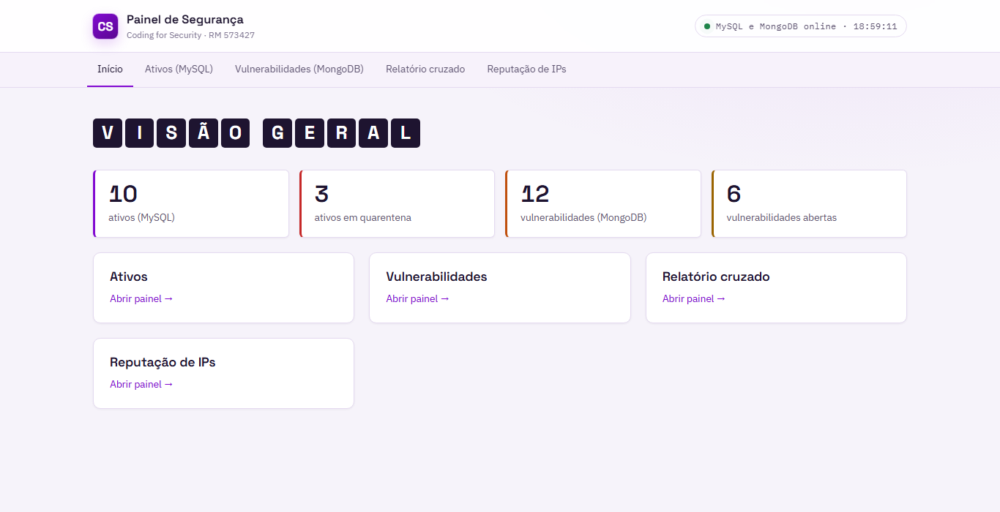
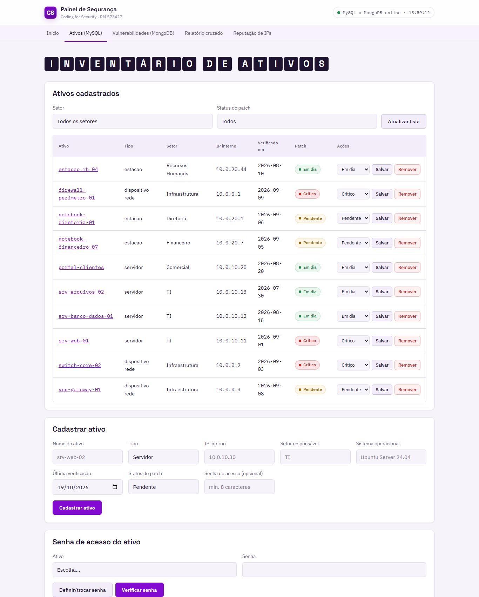
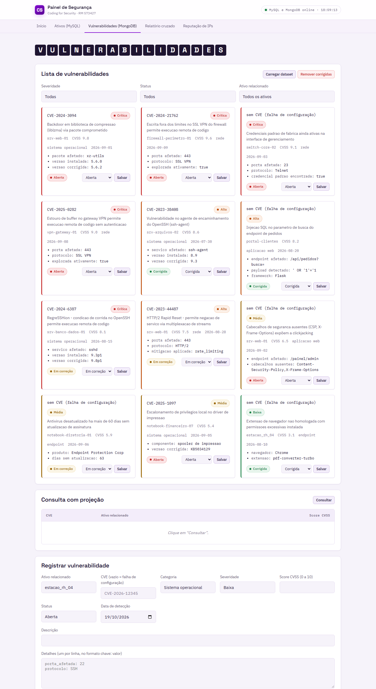
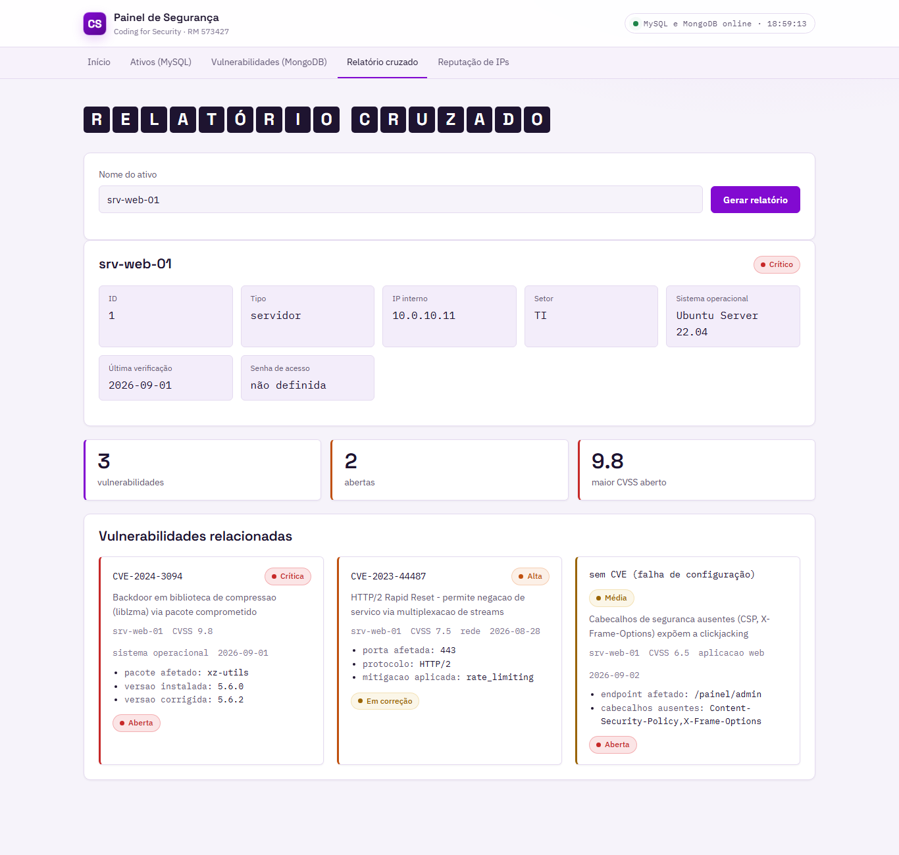
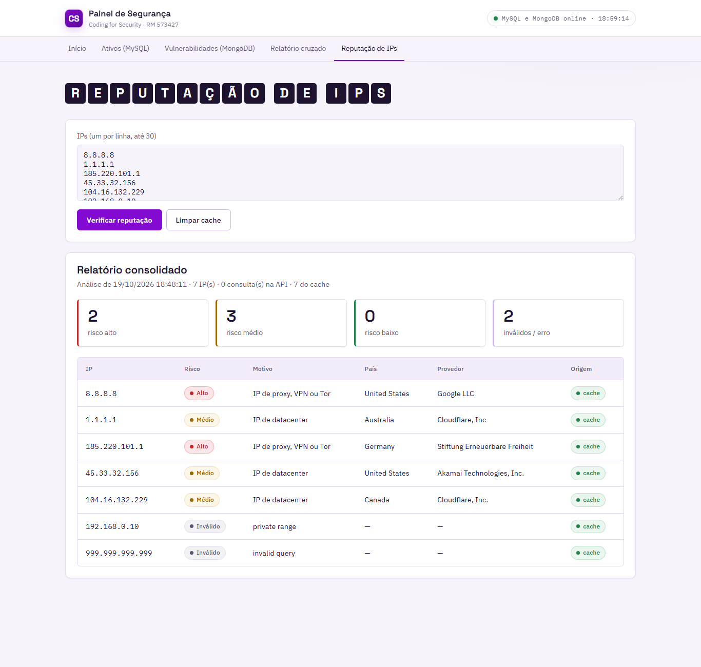
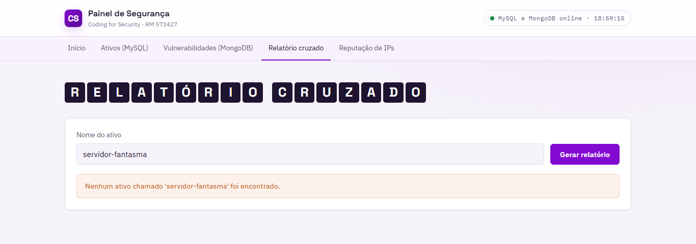

# Painel de Segurança — MVC com Flask, MySQL e MongoDB

Painel web para controlar os **ativos de TI** (guardados no MySQL) e as **vulnerabilidades** encontradas neles (guardadas no MongoDB), com relatório cruzado entre os dois bancos, quarentena automática de ativos críticos e verificação de reputação de IPs.

Projeto acadêmico (Atividade 3) desenvolvido seguindo o padrão **MVC**.



## Stack

| Camada | Tecnologias |
| --- | --- |
| Backend / API | Python 3.11+, Flask 3 (Blueprints) |
| Banco relacional | MySQL (`mysql-connector-python`) |
| Banco de documentos | MongoDB (`pymongo`, com validador de schema) |
| Segurança | `bcrypt` para hash de senhas, credenciais via `.env` (`python-dotenv`) |
| Integração externa | [ip-api.com](https://ip-api.com) (`requests`) com cache local |
| Frontend | HTML, CSS e JavaScript puro (`fetch`) |

## Arquitetura (MVC)

```
navegador (visao/)  ──fetch──▶  controles/ (rotas /api, JSON)  ──▶  modelos/  ──▶  MySQL
                                                                         ├──▶  MongoDB
                                                                         └──▶  ip-api.com
```

| Pasta | Papel |
| --- | --- |
| `modelos/` | Acesso ao MySQL, ao MongoDB e ao ip-api; regras como a quarentena |
| `controles/` | Rotas da API em Flask, que validam a entrada e devolvem JSON |
| `visao/` | Telas em HTML, CSS e JavaScript servidas pelo próprio Flask |
| `dados/` | Dataset de vulnerabilidades, lista de IPs, cache e relatório `.json` |
| `prints/` | Capturas das telas |

O navegador **nunca fala direto com o banco**: a API é a única porta, valida os dados e aplica as regras antes de acessar MySQL ou MongoDB. Assim nenhuma credencial fica exposta no JavaScript.

## Funcionalidades

- **CRUD de ativos** (MySQL): cadastro, alteração de status de patch, exclusão e senha de acesso com hash bcrypt.
- **CRUD de vulnerabilidades** (MongoDB): cadastro, carga em lote, resumo por severidade, mudança de status e limpeza das corrigidas.
- **Relatório cruzado**: junta, no Python, o ativo (MySQL) com suas vulnerabilidades (MongoDB) ligando `nome_ativo` com `ativo_relacionado`.
- **Quarentena automática**: ativo com vulnerabilidade aberta de `score_cvss` acima de 9.0 passa a ter status `critico`. Roda sempre que um ativo ou vulnerabilidade é gravado.
- **Reputação de IPs**: consulta o ip-api.com, guarda as respostas em cache por 24h e gera um relatório consolidado com o risco de cada IP.

## Telas

| Ativos | Vulnerabilidades |
| --- | --- |
|  |  |

| Relatório cruzado | Reputação de IPs |
| --- | --- |
|  |  |

Tratamento de erro para ativo inexistente:



## Como executar

Pré-requisitos: Python 3.11+, MySQL e MongoDB rodando na máquina.

```bash
pip install -r requirements.txt
cp .env.example .env          # ajuste usuário e senha dos bancos
python inicializar_bancos.py  # cria o banco e carrega os dados de exemplo
python app.py
```

Depois abra <http://127.0.0.1:5000>.

Se o MySQL ou o MongoDB não conectar, o servidor não inicia e mostra o motivo no terminal.

## Endpoints da API

| Método | Rota | Banco |
| --- | --- | --- |
| GET / POST | `/api/ativos` | MySQL |
| GET / DELETE | `/api/ativos/<id>` | MySQL |
| PATCH | `/api/ativos/<id>/status` | MySQL |
| PUT | `/api/ativos/<id>/senha` | MySQL |
| POST | `/api/ativos/<id>/senha/verificar` | MySQL |
| GET / POST | `/api/vulnerabilidades` | MongoDB |
| GET | `/api/vulnerabilidades/resumo` | MongoDB |
| POST | `/api/vulnerabilidades/carga` | MongoDB |
| PATCH | `/api/vulnerabilidades/<id>/status` | MongoDB |
| DELETE | `/api/vulnerabilidades/corrigidas` | MongoDB |
| GET | `/api/relatorio/<nome_ativo>` | MySQL + MongoDB |
| POST | `/api/quarentena` | MySQL + MongoDB |
| GET | `/api/saude` | MySQL + MongoDB |
| GET | `/api/reputacao/ips-padrao` | arquivo local |
| POST | `/api/reputacao/verificar` | ip-api.com + cache |
| GET | `/api/reputacao/relatorio` | arquivo local |
| DELETE | `/api/reputacao/cache` | arquivo local |

## Decisões de modelagem

**Por que ativos em tabela e vulnerabilidades em documentos?**
Todo ativo tem os mesmos campos, então cabe numa tabela. Já cada vulnerabilidade tem detalhes diferentes conforme a categoria (porta, endpoint, pacote...), e no MongoDB cada documento guarda só o que precisa.

**Como a API decide qual banco consultar?**
Pela rota: `/api/ativos` usa o MySQL e `/api/vulnerabilidades` usa o MongoDB. O relatório cruzado e a quarentena usam os dois e juntam o resultado no Python.
